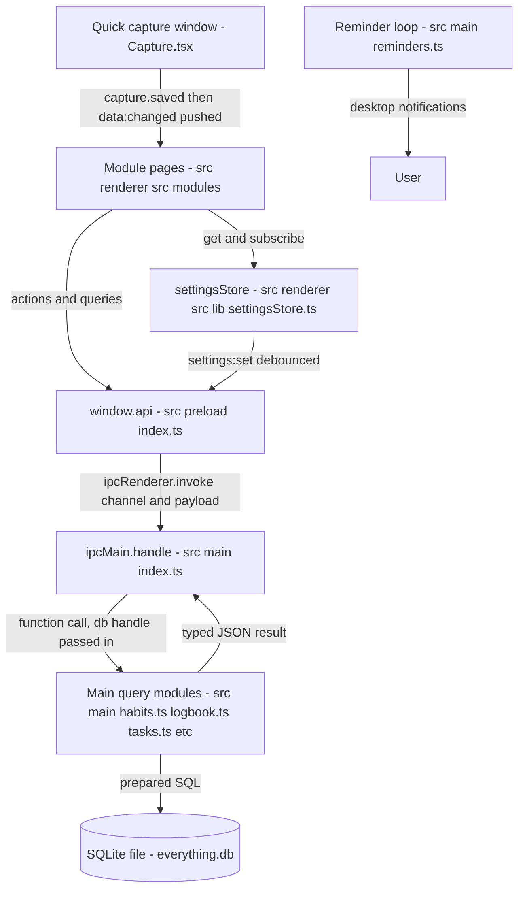
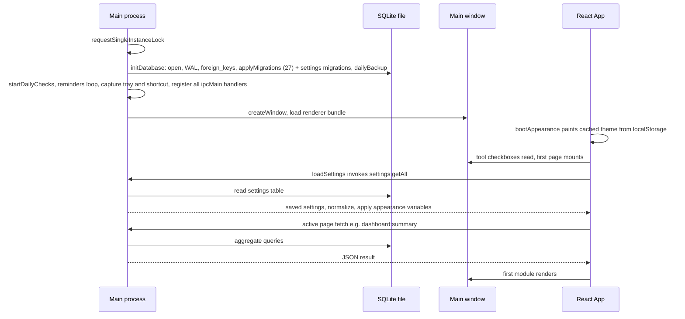
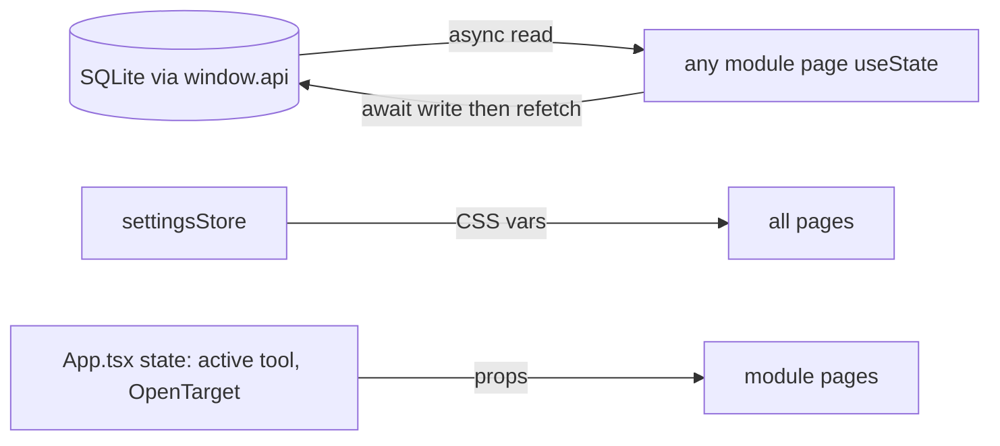
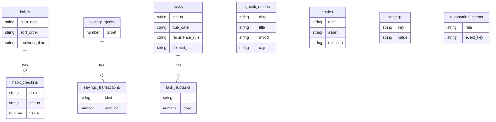
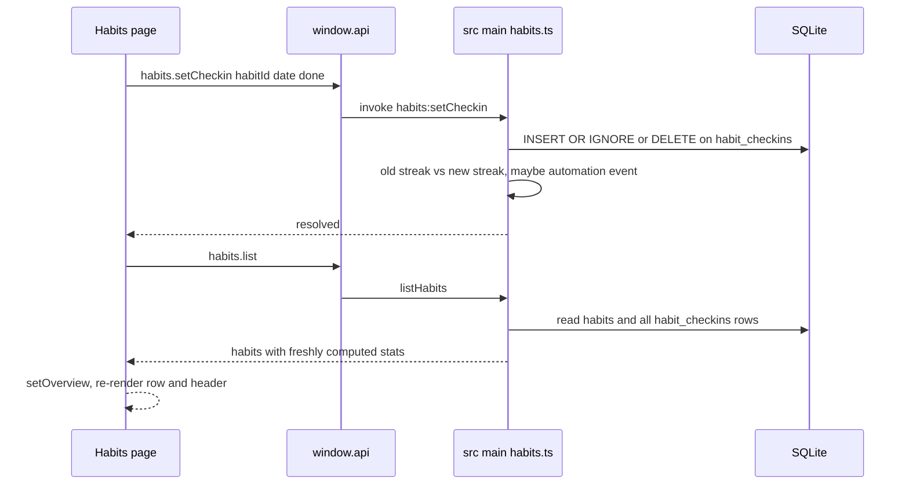
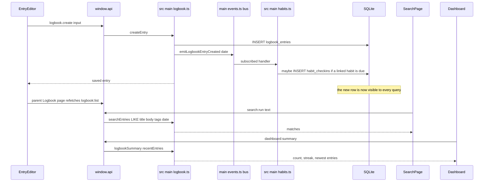

# Feeblest's Everything: Architecture

Last verified: 2026-11-05 (package.json `0.18.0`). Every path and name below was checked against the code on this date.

> **Important correction to the app's own briefs.** The stack is **React + Electron + SQLite (better-sqlite3)**. There are **no Zustand stores, no Dexie/IndexedDB, and no shadcn/ui components** anywhere in the code (searched the whole repo). This document describes what the code actually does. Where a "store" is named, it means the one hand-rolled settings store, not Zustand.

## Table of contents
1. [Overview](#1-overview)
2. [The Big Picture](#2-the-big-picture)
3. [Folder Map](#3-folder-map)
4. [Main Window](#4-main-window)
5. [State Management](#5-state-management)
6. [Database](#6-database)
7. [How the Three Connect](#7-how-the-three-connect)
8. [Module Boundaries](#8-module-boundaries)
9. [Conventions and Rules](#9-conventions-and-rules)
10. [Known Issues and Risks](#10-known-issues-and-risks)
11. [Not Built Yet](#11-not-built-yet)
12. [Glossary](#12-glossary)

---

## 1. Overview

| Layer | Tech | Purpose |
|---|---|---|
| UI | React 18 + TypeScript + Tailwind 3, Lucide icons | One window, 15 module pages, no router |
| State | React `useState` per page + one settings store (`useSyncExternalStore`) | Page data refetched from SQLite on every load/write; only settings live in memory across pages |
| Bridge | Electron `contextBridge` (`window.api`, `src/preload/index.ts`) | The only path between UI and data; ~90 typed IPC channels |
| Logic | Pure rule modules in `src/shared/*.ts` | Streaks, recurrence, palette fuzzy match, appearance, the whole calculator engine — tested with plain `tsx` |
| Workers | Web Workers in the renderer (`src/renderer/src/modules/Calculator/workers/`: `cas.worker.ts`, `graph.worker.ts`, `script.worker.ts` + `harness.ts`) | Calculator CAS, graph sampling and scripts run off the UI thread with time limits and cancellation |
| Data | better-sqlite3, one file at `userData/data/everything.db` | 41 tables + FTS5 search index, 27 append-only migrations (schemaVersion 27), WAL |

**Data flow in one paragraph:** every module page calls a promise-style method on `window.api`; the preload script turns it into `ipcRenderer.invoke('channel', payload)`; the matching handler in `src/main/index.ts` calls a query function in `src/main/<module>.ts` with the SQLite handle from `src/main/db.ts`; the result (plain JSON objects, never DB handles) resolves back to the page, which stores it in local `useState` and re-renders. Writes follow the same path in reverse, and pages re-fetch their lists after each write — there is no client-side data cache to keep in sync.

---

## 2. The Big Picture



How to read it:
- The **renderer** (left) never touches the database. Its only door is `window.api`, made visible by the preload script.
- The **main process** owns the SQLite connection. Each feature's query code (`src/main/habits.ts` and friends) receives the database handle as an argument and runs plain SQL.
- Results travel back as plain JSON; **streaks, review summaries, dashboard numbers and such are recomputed on demand** from raw rows by pure functions in `src/shared/`, so the UI and the numbers never disagree.
- The **Quick capture window** is a second renderer sharing the same code bundle (`src/renderer/src/main.tsx` picks `<Capture />` for URL hash `#capture`). It saves through the same IPC, then the main process pushes a `data:changed` event so open pages refresh (`src/renderer/src/lib/dataChanged.ts`).
- The settings store is the only thing that survives page changes in the renderer; everything else is re-read from SQLite.

---

## 3. Folder Map

```
src/
  main/                  Electron main process; owns the database
    index.ts             Window creation, every IPC handler, app lifecycle
    db.ts                SQLite connection, settings get/set, daily backups
    migrations.ts        27 append-only migrations (user_version)
    habits.ts            habits + habit_checkins queries, stats from shared rules
    logbook.ts           logbook_entries; emits the entry-created event
    trades.ts            trades queries and P&L metadata
    savings.ts           savings_goals + savings_transactions
    tasks.ts             tasks + task_subtasks, recurrence resolution
    automations.ts       automation toggles + activity log (automation_events)
    insights.ts          cross-tool insights, snooze/hide list in settings
    dailyCheck.ts        once-per-local-day checks (streak-broken), dailyCheckState
    dashboard.ts calendar.ts briefing.ts review.ts   one-request aggregators
    search.ts            universal search: calls each module's search function
    calculator.ts        calc_* tables: history (with pin + maxHistoryItems prune), variables, programs, offline currency rate sets/rates/overrides, per-tool settings
    capture.ts           Quick capture window, global shortcut, tray icon
    trayIcon.ts          tray icon images
    reminders.ts         minute loop -> desktop notifications for habit reminders
    assistant.ts         AI assistant settings + encrypted key (safeStorage)
    util.ts              localDate(), tag cleaning, SQL LIKE escaping
  preload/
    index.ts             contextBridge: the whole window.api object
  renderer/
    index.html / main.tsx  entry; chooses <App/> or <Capture/> by URL hash
    src/
      App.tsx            shell: active tool state, global keys, palette host
      tools.ts           THE tool registry: id, name, route, icon (no per-tool key)
      modules/           15 page components (Dashboard, Logbook, Trades, ..., Calculator)
      components/        shared pieces (Sidebar, CommandPalette, WeekStrip, ...)
      lib/               settingsStore, theme, navigation, dates, format, errors
      actions.ts         palette "actions" (open capture, toggle theme, ...)
  shared/                Pure logic, no DOM, no Electron; tests run in tsx
    calculator/          Calculator core (framework-free, import-boundary-tested): parser/ (tokenizer,
                         Pratt parser, ast.ts), evaluator/, registry, numeric/ (decimal.js wrapper),
                         limits.ts (hard input caps), inputs.ts, rates.ts, errors.ts, types.ts,
                         currencyUi.ts, plus modules/ for scientific, statistics, finance, conversions
                         (units, bases, offline currency rates), graphing, linear-algebra, complex, cas,
                         scripting (sandboxed language), datetime; currencyUi.ts holds the history-record shape
    types.ts             All data shapes incl. the EverythingApi IPC contract
    habits.ts            due-day/streak/rate rules, week math, reminders helpers
    backup.ts            backup file format + validation
    appearance.ts palette.ts tasks.ts capture.ts tools.ts ...
tests/                   plain tsx + node:assert, run by `npm test`
docs/                    database-schema.md (STALE), task-manager-improvement-plan.md
```

---

## 4. Main Window

### 4.1 Window creation (`createWindow()` in `src/main/index.ts`)

- Title `APP_NAME`, size **1200×800**, minimum **900×600**. No frameless tricks: normal title bar, `autoHideMenuBar: true`.
- Background colour is pre-resolved from the **saved theme** (`windowBackground()` reads the settings table), and the window is created `show: false`, shown on `ready-to-show` — this is why a light-theme user never sees a dark flash.
- **Window size/position is NOT persisted.** Every launch opens at 1200×800. (Nothing in the code stores bounds — see "Not built yet".)
- Security posture: `contextIsolation: true`, `nodeIntegration: false`; the preload script is the only bridge.
- Navigation guard: any `window.open` or in-page navigation to an `http(s)` URL opens it in the OS browser (`shell.openExternal`, gated by `src/shared/url.ts`); everything else is blocked. The app single web view can only be reloaded.
- **Single instance**: `app.requestSingleInstanceLock()`; a second launch brings the first window forward (`second-instance` → `showMainWindow()`).
- Closing the window quits the app, **unless** Quick capture's "keep running" is on (then the tray icon and global shortcut survive) — `src/main/capture.ts` exposes the flag via `keepsRunning()`. On macOS the app always keeps running, like Macs do.

### 4.2 Two windows, one bundle

| Window | Created by | Content | Notes |
|---|---|---|---|
| Main window | `createWindow()` in `src/main/index.ts` | `<App />` (`src/renderer/src/App.tsx`) | 1200×800, shown on ready |
| Quick capture | `src/main/capture.ts` (`#capture` hash) | `<Capture />` (`src/renderer/src/modules/Capture.tsx`) | ~480px wide overlay, always on top, hides on blur, created hidden at startup, user-configurable global shortcut, tray icon |

Both load the same renderer entry `src/renderer/src/main.tsx`; the hash decides which component roots the page.

### 4.3 IPC: every channel

All `ipcMain.handle` calls live in `src/main/index.ts`; all caller wrappers in `src/preload/index.ts` (namespaced as `window.api.<group>.<fn>`). Payloads are validated in the `src/main/<module>.ts` functions. Two channels travel the *other* way (`ipcRenderer.on` in the preload): `capture:shown` and `data:changed`.

| Group | Channel | Renderer→Main payload | Handler (function, file) | Used by |
|---|---|---|---|---|
| settings | `settings:getAll` | – | `getSettings()` (main/db.ts) | App startup, every settings page |
| settings | `settings:set` | key, value | `setSetting()` + nativeTheme sync | settingsStore debounced writes |
| logbook | `logbook:list` | `LogFilter` | `listEntries` (logbook.ts) | Logbook, Calendar |
| logbook | `logbook:tags` | – | `listTags` | Logbook, Search page tag list, Settings |
| logbook | `logbook:create` | `LogEntryInput` | `createEntry` (also fires automation + habit auto-complete) | EntryEditor, Capture, Review, quickAddSave |
| logbook | `logbook:update` | id, `LogEntryInput` | `updateEntry` | EntryEditor, Review |
| logbook | `logbook:remove` | id | `deleteEntry` | EntryEditor |
| trades | `trades:list` | `TradeFilter` | `listTrades` | Trades |
| trades | `trades:meta` | – | `tradeMeta` (assets/tags) | Trades, Capture, palette quick-add |
| trades | `trades:create` / `update` / `remove` | `TradeInput` | `createTrade` / `updateTrade` / `deleteTrade` | TradeEditor, Capture |
| savings | `savings:listGoals` | – | `listGoals` | Savings, Dashboard, Capture, palette |
| savings | `savings:createGoal` / `updateGoal` / `removeGoal` | `SavingsGoalInput` | `createGoal` / `updateGoal` / `deleteGoal` | GoalEditor |
| savings | `savings:listTransactions` | goalId | `listTransactions` | GoalDetail |
| savings | `savings:addTransaction` / `updateTransaction` / `removeTransaction` | `SavingsTxInput` | `addTransaction` / `updateTransaction` / `deleteTransaction` (no-negative rule) | GoalDetail, Capture, quickAddSave |
| tasks | `tasks:list` | `TaskFilter` | `listFilteredTasks` (resolves recurrence) | Tasks, Settings tags |
| tasks | `tasks:create` / `update` / `remove` | `TaskInput` | `createTask` / `updateTask` / `deleteTask` (hard delete) | TaskEditor, Capture |
| tasks | `tasks:setStatus` / `setStatusMany` | id(s), status | `setTaskStatus` / `setTasksStatus` | Tasks, TaskBoard |
| tasks | `tasks:removeMany` | ids[] | `deleteTasks` | Tasks bulk actions |
| tasks | `tasks:reorder` | ids[] in new order | `reorderTasks` (writes `position`) | Tasks column DnD |
| habits | `habits:list` | – | `listHabits` (stats recomputed via `src/shared/habits.ts`) | Habits, Calendar, Capture, palette |
| habits | `habits:create` / `update` / `remove` | `HabitInput` | `createHabit` / `updateHabit` / `deleteHabit` | HabitEditor |
| habits | `habits:setCheckin` | habitId, `YYYY-MM-DD`, done | `setCheckin` (INSERT/DELETE check-in; streak-break automation) | Habits, Calendar, Capture, quickAddSave |
| habits | `habits:setDayStatus` | habitId, date, `'done'\|'skipped'\|null`, value? | `setDayStatus` | Habits day popover, heatmap |
| habits | `habits:logValue` | habitId, date, value | `logHabitValue` (count/duration habits) | LogValuePopover |
| habits | `habits:reorder` | ids[] in new order | `reorderHabits` (writes `sort_order`) | Habits drag-and-drop |
| dashboard | `dashboard:summary` | today `YYYY-MM-DD` | `getDashboard` | Dashboard |
| review | `review:build` | kind, anchor, today | `getReview` | Review |
| calendar | `calendar:month` | `YYYY-MM`, today | `getCalendar` | Calendar |
| briefing | `briefing:build` | today | `getBriefing` | Briefing |
| search | `search:run` | text, limit | `runSearch` | Search page |
| intelligence | `intelligence:get` / `set` | feature toggles | `getSettings` / `setSetting` (writes `settings.intelligence`) | Intelligence page |
| automations | `automations:get` / `set` | settings patch | `automationSettings` / `setAutomationSettings` (writes `settings.automations`) | Intelligence page |
| automations | `automations:activity` / `activity:delete` / `activity:clear` | id | `automationActivity` / `deleteAutomationActivity` / `clearAutomationActivity` (automation_events; delete/clear mark rows hidden) | Intelligence page |
| automations | `automations:staleTasks` | – | `overdueTasks(db, today)` | Intelligence stale-task automation |
| insights | `insights:build` / `dismiss` | today / id, dismissed, mode?, today? | `getInsights` / `setInsightDismissed` (writes `settings.insightDismissals` as `{ id, until }[]`; snooze = 4 weeks, hide = until restored) | Insights, Review |
| capture | `capture:status` / `configure` / `open` / `hide` / `openMain` / `resize` / `saved` | settings patch / height | capture.ts controller | Capture window, CaptureSettings, quickAddSave |
| app | `app:dataPath` / `app:openDataFolder` | – | `dataDir()` / `shell.openPath` | Settings |
| backup | `backup:exportJson` / `exportTradesCsv` | today | `collectBackup` + save dialog (shared/backup.ts format) | Settings |
| backup | `backup:chooseImport` / `applyImport` | – / file chosen earlier | `parseBackup` (validation) / `restoreBackup` after `safetyCopy()` | Settings |
| intelligence | `intelligence:get` / `set` | feature toggles | settings get/set (`intelligence` key) | Intelligence |
| assistant | `assistant:get` / `set` / `keyStatus` / `setKey` / `clearKey` / `functions` / `ask` | patch / plain key (encrypted immediately) / question | assistant.ts (key stored as encrypted blob via `safeStorage` in `settings.assistantKeyBlob`) | Assistant page |
| calculator | `calculator:saveHistory` / `listHistory` / `clearHistory` / `deleteHistoryItem` / `togglePinHistory` / `saveVariable` / `listVariables` / `deleteVariable` / `saveProgram` / `listPrograms` / `deleteProgram` / `saveRateSet` / `renameRateSet` / `deleteRateSet` / `selectRateSet` / `listRateSets` / `saveRate` / `updateRate` / `listRates` / `saveRateOverride` / `listRateOverrides` / `deleteRateOverride` / `importRateSet` / `getSetting` / `setSetting` / `getAllSettings` | inputs / query parameters | `main/calculator.ts` queries | Calculator tool & history/rate/program adapters |

### 4.4 The app shell and module switching

- There is **no router** and no URL navigation. `src/renderer/src/tools.ts` is the single registry of the tools (id, name, route string like `/trades` which is only a label, category, keywords, `footer: true` for Settings, and the eagerly imported React component; no tool has a key of its own). A `validateTools()` call throws at startup if an entry is malformed.
- `src/renderer/src/App.tsx` holds `active` (a tool id) in `useState`. `navigate(where)` → `findTool()` → `setActive` → and every switch records a **recent tools** entry: `pushRecent()` (`src/shared/palette.ts`) writes `recentTools` into the settings store.
- The page component swaps instantly (`<Page ... />` in `App.tsx`); switching tools **unmounts** the old page, so a fresh mount always re-fetches fresh data from SQLite.
- Pages receive `ModuleProps` (`src/renderer/src/lib/navigation.ts`): `onNavigate(idOrRoute)`, `onOpen(target)` where target is an `OpenTarget` (`{module:'logbook', entry}`, `{module:'trades', trade}`, `{module:'savings', goalId}`), and `target` handled by the receiving page then `onTargetHandled()`. Search results in the Logbook/Trades/Savings open this way.
- **No lazy loading**: all module components are statically imported in `tools.ts`. Fine at this size; noted in Special Notes.

### 4.5 Global features that cross modules

| Feature | Where | How it works |
|---|---|---|
| Command palette | `App.tsx` + `components/PaletteHost.tsx` + `components/CommandPalette.tsx` | Ctrl+K toggles. Items are tools (from tools.ts) + actions (src/renderer/src/actions.ts) shaped by lib/paletteItems.ts; ranking is a pure fuzzy matcher in src/shared/palette.ts |
| Theme / accent / density | lib/theme.ts `applyAppearance()`, lib/settingsStore.ts | Sets `dark` class + `data-style` + CSS variables from src/shared/appearance.ts; Tailwind maps every colour name to those variables (tailwind.config.js) so palettes are data, not rebuilds |
| Global keys | App.tsx key handler, from src/shared/shortcuts.ts | Ctrl+K palette; Ctrl+, Settings; Ctrl+B collapse sidebar; Ctrl+Z undo the last delete. Page keys (Ctrl+N, the Expenses tabs on Ctrl+1..4, the Tasks keys) stay in their pages. Settings > Shortcuts reads the same list. |
| Page-local keys | each module, e.g. Habits Ctrl+N (src/renderer/src/modules/Habits.tsx) | Every page registers its own handlers (save with Ctrl+Enter in editors, Esc closes) |
| Universal search | modules/Search.tsx → `search:run` → src/main/search.ts | Asks logbook, trades, savings for LIKE matches (parsed `#tag` + words via src/shared/search.ts) and bundles results |
| Quick capture | src/main/capture.ts + modules/Capture.tsx | Global shortcut + tray → overlay window; saves via normal IPC; then `capture:saved` handler pushes `data:changed` to the main window; open pages re-fetch via useRefreshOnCapture (lib/dataChanged.ts) |
| Habit reminders | src/main/reminders.ts | Minute loop; desktop notification when a habit is still open at its reminder time; click focuses the app |
| Tag colour editor | components/TagChip.tsx, AppearanceSettings, lib/tagColors.ts | Saved as the `tagColors` setting; applied by CSS variables |

### 4.6 Startup sequence (applyMigrations count is `MIGRATIONS.length` = 27)



Notes: the settings read happens *once* (`loadSettings()` in `App.tsx`'s first effect); the pre-paint uses a localStorage cache (`appearance-cache`) that is refreshed every time settings are applied. A migration failure is backed up, shown in a dialog, and stops startup.

---

## 5. State Management

**There is no Redux/Zustand state library.** The pattern in the renderer is:

1. **One global store for settings** — `src/renderer/src/lib/settingsStore.ts`.
2. **Everything else is page-local `useState`** — each module page holds its own list, form state and busy flags.
3. **Derived values live in `src/shared/*.ts`** — streaks, rates, review/dashboard aggregations, palette ranking. Nothing derived is cached in the renderer; it is recomputed by the main process (or pure functions) on each request.

### 5.1 The one real store

| Store | File | What it holds | Persisted? | Used by |
|---|---|---|---|---|
| settings store | `src/renderer/src/lib/settingsStore.ts` | The whole `Settings` object: theme, palette/accent/uiStyle/radius/density/textSize/font, tag colors, sidebar collapsed + closed groups, recentTools, intelligence features, shortcuts | **Yes** — writes to the SQLite `settings` table (`settings:set`), 200 ms debounced per key; **plus** a localStorage cache (`appearance-cache`, appearance fields only) used only for the first paint | `App.tsx` (tool list, recents, keys), `Sidebar.tsx` (collapsed/groups/theme), `SettingsPage`/`AppearanceSettings` (editing), `Dashboard.tsx` (intelligence toggles), `CommandPalette` (recentTools), `Review.tsx`, `Tasks.tsx`, palette actions (theme toggle) |

State shape (key fields, from `Settings` in `src/shared/types.ts`, normalised by `src/shared/appearance.ts`):

```
theme: 'light'|'dark'|'system'; palette/accent/uiStyle/radius/density/textSize/font
sidebarCollapsed: boolean; sidebarClosedGroups: string[]; recentTools: string[]
tagColors: Record<string,string>; capture: CaptureSettings; intelligence: {...}
shortcuts: {...}
```

Actions exposed by `src/renderer/src/lib/settingsStore.ts`:

| Action | What it does | Touches DB? |
|---|---|---|
| `bootAppearance()` | pre-paint from localStorage cache (sync, first call) | No (cache only) |
| `loadSettings()` | reads truth from DB (`settings:getAll`), normalises, applies CSS vars, refills tag colours | **Yes (read)** |
| `updateSettings(patch)` | merges + normalises, applies instantly, then debounced `settings:set` per changed key | **Yes (write, debounced 200 ms)** |
| `resetAppearance()` / `toggleTheme()` | convenience wrappers around `updateSettings` | via updateSettings |
| `useSettings()` | subscription hook (`useSyncExternalStore`) for re-rendering on any change | No |

Side effects of the same store: `setTagColors` (lib/tagColors.ts) pushes tag colours as CSS variables; `applyAppearance` toggles the `dark` class and sets every token variable.

### 5.2 Everything else is page state (with a DB refetch pattern)

| Page (module) | Data it holds in `useState` | Refreshed from |
|---|---|---|
| `modules/Dashboard.tsx` | one `DashboardData` | `dashboard:summary` on mount + `data:changed` push |
| `modules/Logbook.tsx` | entries + tag list | `logbook:list`/`tags` |
| `modules/Trades.tsx` | trades + meta | `trades:list`/`meta` |
| `modules/Savings.tsx` | goals | `savings:listGoals` |
| `modules/Habits.tsx` | `HabitsOverview` (all habits + precomputed stats) | `habits:list`, after every write, on window refocus (`window.onfocus`), on `data:changed` |
| `modules/Tasks.tsx`, `TaskBoard.tsx` | tasks list | `tasks:list` after every change |
| `modules/Search.tsx` | one search result set | per query |
| `modules/Calendar.tsx` / `Review.tsx` / `Briefing.tsx` / `Insights.tsx` | one computed snapshot | per period/month request |
| editors (`EntryEditor`, `TradeEditor`, `HabitEditor`, `GoalEditor`, `TaskEditor`) | form fields only | save = one IPC call + parent refetch |

**Rules the code follows (observable, all verified):**
- Page data is **never cached across pages**. Switching tools unmounts the page; the next visit re-mounts and re-fetches. There is no stale-data problem, at the cost of refetching.
- Writes are **not optimistic**: the UI calls the IPC write, awaits it, then calls `refresh()` which re-reads the list from SQLite (see `Habits.tsx` `toggle/chooseDay/saveValue`, `Tasks.tsx` `setStatus` flows). The DB is the only truth; the page always mirrors a fresh read.
- Cross-module navigation payloads (`OpenTarget`) are transient `App.tsx` state; the receiving page consumes them and clears.
- Nothing subscribes to "data changed by another page" in the same window: a page stays fresh only because it re-mounts or refetches after its own writes (and because the capture window sends `data:changed`).

### 5.3 Store-to-store sync

There are **no store-to-store dependencies** — there is only one store. Transient value sharing goes: `App.tsx` (active tool, target, palette open) → provider props into pages. Data sharing goes through SQLite plus refetch, always:



### 5.4 Hydration and the second window
- Hydration = `loadSettings()` once at startup; page data has no hydration step by design (mount = fetch).
- The **Quick capture window is a separate React root** of the same store code (its own `settingsStore` instance reading the same SQLite). It does not live-sync with the main window; after saving it calls `window.api.capture.saved()`, and the main process pushes `data:changed` (see 4.3) — that is the entire sync mechanism.

---

## 6. Database

### 6.1 The file and the version

- **Engine:** better-sqlite3, **file:** `everything.db` inside `userData/data/` (`dataDir()` in `src/main/db.ts`).
- **Pragmas:** `journal_mode = WAL`, `foreign_keys = ON` (both set in `initDatabase`).
- **Schema version:** the SQLite `user_version` pragma, equal to `MIGRATIONS.length` = **27**. Before applying migrations the app creates a database copy in `data/before-migrate/` (newest three kept); if backup or migration fails, startup shows an error and stops. `applyMigrations()` in `src/main/migrations.ts` runs pending entries (each wrapped in a transaction), so old databases upgrade in place.

### 6.2 Version history (27 migrations)

| Ver. | What changed | Migration notes |
|---|---|---|
| 1 | `settings` key/value table | JSON values in TEXT |
| 2 | `logbook_entries` + date index | tags as JSON array string |
| 3 | `trades` + date index | P&L never stored; computed |
| 4 | `savings_goals`, `savings_transactions` + goal index | balance computed from rows |
| 5 | `habits`, `habit_checkins` (PK habit_id+date) | check-in = one done day |
| 6 | `tasks`, `task_subtasks`, indexes | recurrence + parent_task_id (later reworked) |
| 7 | dedupe task parent links + unique index | later dropped by v9 |
| 8 | `automation_events` + unique dedupe index | one row per thing an automation did |
| 9 | **tasks rework**: `due_time`, `deleted_at` (soft delete), `position` (sort), `recurrence_rule`/`recurrence_next`; drops old parent/recurrence columns | replaces parent-copy recurrence with one rule per row |
| 10 | `habit_checkins.status` (`done`/`skipped`) | default 'done'; old rows keep meaning |
| 11 | `habits.type/target/unit`, `habit_checkins.value` | check/count/duration habits; old rows = 'check' |
| 12 | `habits.sort_order` (backfilled from creation order), `habits.time_of_day` | drag-and-drop order, grouping |
| 13 | `habits.reminder_time`, `habits.auto_complete_on` | reminders + Logbook link; defaults = off |
| 14 | `task_completions` + completed-at index | preserves each completed occurrence, including recurring tasks |
| 15 | `automation_events.hidden` | hides activity without removing deduplication claims |
| 16 | `trades.closed_at` (ISO timestamp) | stamped open→closed and on create-already-closed; old rows NULL and silent for the quick-re-entry rule |
| 17 | **Phase 0 soft delete everywhere**: `deleted_at`, `delete_batch_id` on all user-facing tables; backfills `tasks.updated_at` | soft delete and group batch undo across logbook, trades, savings, habits, tasks |
| 18 | `links` table + bidirectional indexes | generic cross-entity links with normalized source/target ordering |
| 19 | `tags` and `taggings` tables + unique indexes | shared tags foundation across entities |
| 20 | `templates` table | saved starter templates with `{{date}}`, `{{weekday}}`, `{{time}}` variables |
| 21 | `search_index` FTS5 virtual table | shared full-text search index across all modules |
| 22 | **Phase 1 expenses**: `expense_categories` (seeded), `expense_transactions`, `expense_budgets`, `recurring_bills`, `recurring_bill_occurrences` (unique `recurring_id + due_date`) | money as integer cents + currency; soft delete everywhere |
| 23 | **Phase 2 notes**: `notes` (title, title_key for `[[wiki links]]`, body, tags, pinned, archived) + indexes | markdown pages, soft delete; built-in templates seeded in code (`src/main/builtinTemplates.ts`) |
| 24 | **Phase 3 content**: `content_items` (stage, position, script_note_id, checklist/stage_dates/assets JSON, stream + post-publish fields) + indexes | fixed six-stage pipeline; assets by path only |
| 25 | **Phase 4 focus**: `projects`, `time_sessions`, `active_focus_session` | pomodoro & count-up timer, midnight splitting, active session persistence across restarts |
| 26 | **Phase 5 tools**: `snippets`, `scratchpads` | saved snippets and autosaving plain-text pads |
| 27 | **Phase 12 calculator**: `calc_history`, `calc_variables`, `calc_programs`, `calc_rate_sets`, `calc_rates`, `calc_rate_overrides`, `calc_settings` | calculation history, saved programs, variables, offline currency rate sets & overrides |

A backup file also records `schemaVersion` (`MIGRATIONS.length`) so an import is validated against the current schema (`src/shared/backup.ts`).

### 6.3 Every table

Tables are created in `src/main/migrations.ts`; all queries are in the named module file under `src/main/`.

| Table | Query file | Primary key | Indexes | Key fields | Module |
|---|---|---|---|---|---|
| `settings` | main/db.ts (+ automations, insights, assistant, capture) | `key` | PK only | `value` (JSON) | core (settings, intelligence, assistant key blob, capture config, insight dismissals) |
| `logbook_entries` | logbook.ts | `id` | `idx_logbook_date(date)` | date, title, body, mood, tags(JSON), created/updated | Logbook |
| `trades` | trades.ts | `id` | `idx_trades_date(date)` | date, asset, direction, entry/exit price, quantity, fees, closed_at (ISO, migration 16), tags(JSON) | Trades |
| `savings_goals` | savings.ts | `id` | – | name, target, notes | Savings |
| `savings_transactions` | savings.ts | `id` | `idx_savings_tx_goal(goal_id,date)` | goal_id (FK CASCADE), date, kind, amount, note | Savings |
| `habits` | habits.ts | `id` | – (single-row reads dominate) | name, days(JSON number[]), archived, start_date, type, target, unit, sort_order, time_of_day, reminder_time, auto_complete_on | Habits |
| `habit_checkins` | habits.ts | **composite** `(habit_id, date)` | the PK | status ('done'/'skipped'), value (count/duration), created_at | Habits |
| `tasks` | tasks.ts | `id` | `idx_tasks_due_status`, `idx_tasks_deleted` | title, status, priority, due_date/due_time, position, recurrence_rule(JSON)/recurrence_next, deleted_at, tags(JSON), project, delete_batch_id, updated_at | Tasks |
| `task_completions` | tasks.ts | `id` | `idx_task_completions_completed_at` | task_id (FK), completed_at (each historical occurrence) | Tasks, Assistant, Insights |
| `task_subtasks` | tasks.ts | `id` | – | task_id (FK CASCADE), title, done, sort_order | Tasks |
| `automation_events` | automations.ts | `id` | `idx_automation_once(rule,event_key)` unique | rule, event, event_key, label, entry_id, hidden | Intelligence automations |
| `links` | links.ts | `id` | `idx_links_source`, `idx_links_target`, `idx_links_once` | source_type, source_id, target_type, target_id, relation, created_at, deleted_at | Links service |
| `tags` | tags.ts | `id` | name unique | name, colour, created_at, updated_at | Tags service |
| `taggings` | tags.ts | `id` | `idx_taggings_entity`, `idx_taggings_once` | tag_id (FK CASCADE), entity_type, entity_id, created_at, updated_at, deleted_at | Tags service |
| `templates` | templates.ts | `id` | – | kind, name, payload(JSON), is_builtin, created_at, updated_at, deleted_at | Templates engine |
| `search_index` (FTS5) | searchIndex.ts / search.ts | – | FTS5 full-text | entity_type UNINDEXED, entity_id UNINDEXED, text | Universal search |
| `notes` | notes.ts | `id` | `idx_notes_title_key`, `idx_notes_deleted`, `idx_notes_archived` | title, title_key, body, tags(JSON), pinned, archived | Notes |
| `content_items` | content.ts | `id` | `idx_content_stage`, `idx_content_publish`, `idx_content_deleted` | title, type, platform, hook, stage, position, series, tags, target/published dates, script_note_id (FK notes), checklist/stage_dates/assets(JSON), stream*, views* | Content planner |
| `projects` | focus.ts | `id` | name unique, `idx_projects_deleted` | name, colour, archived, created_at, updated_at, deleted_at | Focus & Projects |
| `time_sessions` | focus.ts | `id` | `idx_time_sessions_started`, `idx_time_sessions_task`, `idx_time_sessions_project`, `idx_time_sessions_deleted` | task_id (FK), project_id (FK), started_at, ended_at, planned_seconds, actual_seconds, type, completed, note, source | Focus & Sessions |
| `active_focus_session` | focus.ts | `id` (PK=1) | – | status, mode, type, started_at, target_seconds, elapsed_seconds, paused_at, round, task_id, project_id | Focus Timer |
| `snippets` | tools.ts | `id` | `idx_snippets_deleted` | title, body, tags(JSON) | Tools hub |
| `scratchpads` | tools.ts | `id` | `idx_scratchpads_deleted` | name, content, position | Tools hub |
| `calc_history` | calculator.ts | `id` | `idx_calc_history_created` | created_at, mode, input, result, result_format, rate_snapshot, pinned | Calculator |
| `calc_variables` | calculator.ts | `name` | PK only | value, updated_at | Calculator |
| `calc_programs` | calculator.ts | `id` | – | name, source, created_at, updated_at | Calculator |
| `calc_rate_sets` | calculator.ts | `id` | – | name, base_currency, is_active, updated_at | Calculator |
| `calc_rates` | calculator.ts | `id` | unique (rate_set_id, currency_code) | rate_set_id, currency_code, name, rate_to_base, note, updated_at | Calculator |
| `calc_rate_overrides` | calculator.ts | `id` | unique (rate_set_id, from_code, to_code) | rate_set_id, from_code, to_code, rate, updated_at | Calculator |
| `calc_settings` | calculator.ts | `key` | PK only | value (JSON) | Calculator |

### 6.4 Entity relationships



Both rows of the linking tables are owned by strict rules: `habit_checkins` FK is `ON DELETE CASCADE` (deleting a habit removes its history), and a "missed"/"rest" day is **never stored** — only `done` (optionally with a value) and `skipped` exist.

### 6.5 Where database access happens

**All SQL lives in the main process.** Access pattern: `src/main/index.ts` holds no SQL itself; it passes `getDb()` into function-per-operation modules. The renderer never imports better-sqlite3 (verified by search; only `src/main/*` and `tests/sqlite.ts` load it).

| File | What SQL it runs |
|---|---|
| `src/main/db.ts` | connection, settings get/set, daily + safety backups |
| `src/main/habits.ts` | habits + check-ins CRUD, setDayStatus/logValue, autoCompleteOnDay |
| `src/main/logbook.ts` | entries CRUD, tags aggregation, search |
| `src/main/trades.ts` | trades CRUD, meta, search |
| `src/main/savings.ts` | goals/transactions CRUD + search, no-negative rule |
| `src/main/tasks.ts` | tasks/subtasks CRUD, status bulk, reorder, recurrence resolution |
| `src/main/automations.ts` | event log insert/select, settings read for toggles |
| `src/main/reminders.ts` | reads habit lists each minute (via habits.ts functions) |
| `src/main/dailyCheck.ts` | reads/writes `settings.dailyCheckState`; the streak check reads habit completions |
| `src/main/insights.ts` | reads/writes `settings.insightDismissals` (`{ id, until }[]`) |
| `src/main/dashboard.ts` / `calendar.ts` / `briefing.ts` / `review.ts` / `insights.ts` | **no own SQL** — call the module query functions and pure shared helpers, then aggregate |
| `src/main/search.ts` | **no own SQL** — calls each module's search function |
| `src/main/backup.ts` | full-table export and import-restore (trades carry `closedAt`; includes calculator `calc_*` tables)
| `src/main/index.ts` | a few small read exceptions (`automations:staleTasks` filters `listTasks` in JS; counts via `currentCounts`) |

So: no repository/service *class* exists — the "layer" is the module-file convention (one file per table group, `db` passed in). Documented as-is.

### 6.6 Conventions in use

- **Dates** are always local `YYYY-MM-DD` strings, built with `localDate()` (`src/main/util.ts`) in the main process and `today()` (`src/renderer/src/lib/dates.ts`) in the UI; date math is done in `src/shared/habits.ts` on UTC-based calendar days so time zones can't shift a day. `today` is passed as a parameter, so a renderer page and the main process can never disagree about which day it is.
- **IDs**: SQLite `INTEGER PRIMARY KEY AUTOINCREMENT`.
- **Timestamps**: ISO strings `created_at`/`updated_at` set on every write.
- **JSON-in-TEXT columns**: `tags`, `habits.days`, `tasks.recurrence_rule` (parsed with `JSON.parse` at the edge of the query file).
- **Soft delete vs hard delete**: every user-facing table uses `deleted_at` and `delete_batch_id` (migration 17); queries read live rows through the `LIVE()` helper in `src/main/repo.ts`. Trashed rows are excluded from all totals and can be undone or restored via Trash (`src/main/trash.ts`), with auto-purge after configurable retention (default 30 days). Foreign keys enforced by `foreign_keys = ON`.
- **Migrations**: append-only array in `src/main/migrations.ts`, applied by counting `user_version`, each in a transaction; never edit an old entry.
- **Backups**: automatic daily copy kept 14 days (`dailyBackup` in db.ts); a manual JSON export through `backup:exportJson` (format + validation in `src/shared/backup.ts`), trades-only CSV export; import → validate (`parseBackup`), `safetyCopy()` (kept 5) of the current DB, then full restore. The AI assistant's API key is stored in the `settings` table as an **encrypted blob** (Electron `safeStorage`), never in plain text. JSON exports omit it; daily `.db` copies can contain the ciphertext.

---

## 7. How the Three Connect

### Flow A — User checks off a habit



1. `src/renderer/src/modules/Habits.tsx` — the left circle button calls `toggle()` → `window.api.habits.setCheckin(h.id, date, ...)` while `busyKey` shows a saving state.
2. `src/preload/index.ts` invokes channel `habits:setCheckin`.
3. `src/main/index.ts` line ~170 routes it to `habits.setCheckin(getDb(), habitId, date, done)` in `src/main/habits.ts`.
4. There the date is validated (not in the future), the row is inserted or deleted, and the streak before/after is compared so a broken 7+ streak can raise an automation event (`src/main/automations.ts`).
5. The page then calls `refresh()` → `window.api.habits.list()` → `listHabits` recomputes every habit's stats with `computeHabitStatsFromCompletions` (`src/shared/habits.ts`), returns the whole `HabitsOverview`, and the page re-renders — header, streaks, dots and the completion progress bar are all derived from this one fresh read.
6. The **Dashboard tile does not live-update from this**: it shows data from its own `dashboard:summary` request. Keeping the app's rule "the DB is truth, pages re-fetch", the tile is fresh next time the Dashboard mounts or `data:changed` arrives.

**If this breaks, look at:** `src/main/habits.ts` (rules + SQL), `src/shared/habits.ts` (pure streak rules), `src/renderer/src/modules/Habits.tsx` (busyKey/refetch).

### Flow B — App startup

Already diagrammed in 4.6. In words:
1. `src/main/index.ts`: single-instance lock → `initDatabase()` (`src/main/db.ts`: open, WAL, FKs, migrations, daily backup) → reminders loop → capture window/tray → all IPC handlers registered → `createWindow()`.
2. `src/renderer/src/main.tsx`: `bootAppearance()` paints the cached theme instantly, then renders `<App />` (or `<Capture />` for the `#capture` hash).
3. `App.tsx` effect 1: `loadSettings()` → `settings:getAll` → normalise → `applyAppearance()` sets the `dark` class + all CSS variables → theme is now the saved one.
4. `App.tsx` also filters the tool list by the Intelligence toggles; the first page (Dashboard, `START_TOOL` in tools.ts) mounts.
5. That page issues its request (e.g. `dashboard:summary` → `src/main/dashboard.ts` → several module queries + shared aggregation) and renders.

**If this breaks, look at:** `src/main/index.ts` (lifecycle), `src/main/db.ts` + `src/main/migrations.ts`, `src/renderer/src/lib/settingsStore.ts`.

### Flow C — Create a Logbook entry; it appears in Search and the Dashboard



1. `src/renderer/src/modules/EntryEditor.tsx` `save()` → `window.api.logbook.create(input)` (or `update`).
2. `src/main/logbook.ts` `createEntry` inserts the row, then (a) records/uses the automation system (skipped for `#automation` drafts to prevent loops) and **(b) emits `emitLogbookEntryCreated(db, {date})` on the small event bus `src/main/events.ts`** — the habits module subscribed to that bus when it was loaded, so a habit with "auto-complete on Logbook entry" is ticked off *only if due, and only if the day has no record yet* (`src/main/habits.ts` `autoCompleteOnDay`). The Logbook never imports habit code — this is the deliberate decoupling.
3. **Universal search** (`modules/Search.tsx`) calls `search:run` → `src/main/search.ts` → `searchEntries` (`LIKE` with `%`/`_` escaped) — the new row is matched immediately, because search always queries the DB live (`src/main/trades.ts`, `src/main/savings.ts` likewise).
4. **Dashboard**: `dashboard:summary` → `getDashboard` → `logbookSummary` (writing streak via `logStreak` in `src/shared/dashboard.ts`) and `recentEntries`. Fresh on every dashboard request.
5. The editing page refetches its list after the write resolves (`Logbook.tsx` reloads entries + tags).

**If this breaks, look at:** `src/main/logbook.ts` (create + event emit), `src/main/events.ts` → `src/main/habits.ts` `autoCompleteOnDay` (the habit link), `src/main/search.ts` (search aggregation).

---

## 8. Module Boundaries

| Module | Owns tables | Exposes | Depends on |
|---|---|---|---|
| Logbook | `logbook_entries` | list/create/update/delete, tags, search, its data to calendar/review/dashboard/briefing via its query functions | shared (moods, search parsing) |
| Trades | `trades` | CRUD, meta, search; P&L *computed* by src/shared/trades.ts | shared/trades, shared/math |
| Savings | `savings_goals`, `savings_transactions` | CRUD + search, balance derived | shared/savings (progress) |
| Habits | `habits`, `habit_checkins` | CRUD, day-status, logValue, reorder; legacy check-in toggles use day-status replacement; listens to logbook events (auto-complete) | shared/habits (all rules), main/events.ts |
| Tasks | `tasks`, `task_subtasks` | CRUD, status, bulk, reorder, recurrence resolution | shared/tasks |
| Intelligence (automations/insights/assistant) | `automation_events`; **writes into `settings`** (`intelligence`, `automations`, `insightDismissals`, `assistant`, `assistantKeyBlob`) | toggles, activity log, insights build/dismiss, assistant ask | automations emit from tool writes, including newly closed trades; shared/insights* |
| Search (main) | none | `runSearch` bundling | logbook/trades/savings search fns, shared/search |
| Dashboard / Review / Calendar / Briefing / Insights | none (aggregators) | one-request snapshots | **every module's query functions** + shared aggregators (src/shared/dashboard.ts, review.ts, insightsData.ts, calendar.ts) |
| Settings (core) | `settings` | get/set to everyone | shared/appearance (normalisation) |
| Capture (window) | none | overlay save flows | all save-able modules' IPC (via same window.api), readSettings/saveSetting deps |

**Cross-boundary call-outs (as-is in the code):**
- `src/main/automations.ts` catches and logs failures from automation settings, rules, or activity writes. Each event emitter can therefore fail independently without turning a completed Logbook, trade, savings, task, or habit save into an apparent failure.
- Automation activity uses a transactional claim-before-action flow; its unique event key remains durable when a row is hidden. Draft dates use the machine's local calendar date.
- The normalized `automation` tag is the shared test for automation-made entries. Drafts remain visible in entry lists but are excluded from authored writing totals/streaks and journal mood statistics.
- `settings:set` accepts only `DEFAULT_SETTINGS` keys and rejects main-owned settings; `settings:getAll` excludes the encrypted assistant key. Intelligence features, automations, and insight dismissals are stored separately and written by the main process.
- `assistantKeyBlob` is deleted when the user removes a key. `assistant:keyStatus` reports whether a saved blob can be read on this computer without returning the key itself.
- Assistant settings patches keep only known, length-limited values; a cloud URL change clears confirmation. Requests refuse redirects and limit questions to 500 characters. Assistant reply dates are validated as calendar dates, future endpoints are clamped to today, and ranges over 1,830 days or wholly in the future are rejected before calculations. JSON backup restores reset the provider and cloud confirmation, retaining only a valid model name and local URL while dropping imported key blobs and legacy provider values.
- **Assistant privacy contract:** local mode accepts only loopback endpoints. Cloud mode requires HTTPS and explicit confirmation for the normalized URL; the provider receives the fixed system prompt, today's local date and the user's question, with the key in the authorization header. No database rows, computed results or chat history are sent. The model selects an allowlisted read-only function; the app runs it locally and returns the numeric result in the current page session. Chat history is not persisted.
- Automation draft entries are tagged `automation` and excluded from authored-writing totals, streaks and journal mood statistics. Clearing the Automation activity list hides rows only; it retains generated drafts and deduplication claims, so cleared triggers cannot repeat.
- A `trade-closed` automation event is emitted both when a trade is created already closed and when an existing trade transitions from open to closed.
- `src/main/reminders.ts` imports `src/main/habits.ts` functions — a main-process module reaching into another module is fine by design (both own their tables), but the habit rule it depends on (`getDayStatus`) is deliberately in `src/shared/habits.ts` so both windows of rendering agree.
- `src/main/dashboard.ts` imports almost every module file. It is the one intentional "top" of the dependency graph; nothing else should import *it*.
- In the renderer, module pages never import each other; they meet only through `OpenTarget` and `onNavigate` (`src/renderer/src/lib/navigation.ts`).

### Intelligence settings keys

These related settings are stored as separate rows in SQLite's `settings` table. Main-process handlers own updates so a change to one key cannot overwrite another.

| Key | Contents | Writer |
|---|---|---|
| `intelligence` | Per-feature switches (`dailyBriefing`, `automations`, `smartQuickAdd`, `insights`, `aiAssistant`) | `intelligence:set` |
| `automations` | Rule switches and thresholds | `automations:set` |
| `insightDismissals` | Dismissed IDs from the finite shared `INSIGHT_IDS` list | `insights:dismiss` |
| `assistant` | Provider, local/cloud URLs, model name and cloud confirmation | `assistant:set` |
| `assistantKeyBlob` | Encrypted `safeStorage` ciphertext; never the plaintext key | Assistant key handlers |

JSON exports omit `assistantKeyBlob`; local SQLite database copies may contain the encrypted blob.

### Automation event sources

The event kinds are declared in `src/shared/automations.ts`; writers in `src/main/` emit them after the corresponding save.

| Event | Emitted by | Built-in listener |
|---|---|---|
| `trade-closed` | `createTrade` for a trade entered already closed; `updateTrade` when an open trade closes | Loss reflection |
| `savings-deposit` | `addTransaction` for a deposit | Goal celebration receives it but takes no action; a crossing emits a separate `goal-reached` event |
| `goal-reached` | `addTransaction` when a deposit takes the goal across its target | Goal celebration |
| `habit-streak-broken` | `setDayStatus` when a streak of at least seven days decreases | Broken-streak note |
| `task-completed` | `setTaskStatus` when a task is completed | Stale-overdue-task scan |
| `journal-entry-saved` | `createEntry` for a user-written entry (automation drafts do not emit it) | Stale-overdue-task scan |

The separate `src/main/events.ts` Logbook-entry bus emits after user-written entries so linked habits can auto-complete; it is not an `AutomationEventKind`.

---

## 9. Conventions and Rules

Rules a new contributor must follow, as they actually work in the code:

- **No new dependencies without asking** (AGENTS.md). SQLite (better-sqlite3) and Electron are the only runtime deps today.
- **Business rules are pure functions in `src/shared/`**, testable with plain `tsx` + `node:assert` in `tests/`; `npm test` runs the list in `package.json`, and `npm run typecheck` type-checks `tests/` too. Both must pass before anything is "done".
- **`src/main/<module>.ts` files stay thin**: fetch/save/SQL + validation. They receive the `Database` handle; they never import each other's tables (aggregators like dashboard.ts are the exception at the top).
- **The renderer never touches SQL or Electron directly** — only `window.api` methods typed by `EverythingApi` in `src/shared/types.ts`. Preload additions must mirror an `ipcMain.handle`.
- **Theme uses tokens only** — no hardcoded colours; Tailwind colour names map to CSS variables set by `applyAppearance` (`src/shared/appearance.ts` decides values; `styles.css` consumes them).
- **Dates are local `YYYY-MM-DD` strings**; stats/rules live in `src/shared/habits.ts`, including `habitRateInRange` shared by the Habits page, Assistant and Insights so due days, skips, targets, effective starts, future dates and a still-pending day today are handled consistently.
- **Schema change = append a migration** to `src/main/migrations.ts`, bump nothing else (`user_version` does the rest); default new columns so old data keeps its meaning.
- **Where state lives**: settings → settingsStore; everything else → DB + page `useState` refetch. Don't cache domain data in the renderer.
- **Update `README.md`/CHANGELOG** when behaviour changes; list every behaviour change explicitly.

### Checklist: adding a new module

1. Pure rules → `src/shared/<module>.ts` (add the test to the `npm test` chain in `package.json`).
2. Table (if any) → new migration entry in `src/main/migrations.ts`.
3. Query functions → `src/main/<module>.ts`, `db` as first parameter.
4. IPC handlers → `src/main/index.ts`.
5. Bridge → `src/preload/index.ts` + the `EverythingApi` group in `src/shared/types.ts`.
6. Page component → `src/renderer/src/modules/<Module>.tsx`.
7. **One entry** in `src/renderer/src/tools.ts` (id/name/route/category/keywords/icon/component; the `validateTools` throw catches mistakes at startup).
8. If it should appear in universal search → a `searchX` function + hook it into `src/main/search.ts` AND `src/shared/search.ts` groups; **and** into `backup.ts` export/import so user data round-trips.
9. Update `README.md` (what it does, any config) and `CHANGELOG.md`.

---

## 10. Known Issues and Risks

Honest list from reading the code (ranked by severity):

1. **Stale architecture documentation — `docs/database-schema.md`.** It claims "7 migrations"; there are **27**, and it omits the tasks rework (soft delete, position, recurrence rules), habit types/values, organisation columns, the Logbook-link/reminder columns, task completion history, automation-event hiding, the trade close timestamp and the calculator `calc_*` tables (migration 27). Anyone trusting it will write wrong SQL. Fix: regenerate it from `src/main/migrations.ts` (or replace it with this file + a pointer).
2. **Duplicate computation risk on `habits:list`.** `listHabits` reads *all* check-in rows and recomputes up to 10 years of day-by-day stats for *every* habit on every request (walks in `src/shared/habits.ts`). It's fine for hundreds of habits, but the Tab complete/Search/calendar calls also hit it (Calendar/Capture/palette call `habits:list`). Small fix if it ever grows: compute stats lazily per habit requested, or cache `completionsOf` per db handle.
3. **Settings debounce can lose a change in a crash window.** `settingsStore.ts` `persist()` waits 200 ms before `settings:set`; app closed within that window keeps the old value on disk (screen shows the new one). Small fix: flush pending settings on `beforeunload`/capture window close.
4. **Some `window.api.*` calls have no `.catch`.** Most pages wrap their fetches in try/catch (for example `src/renderer/src/modules/Calendar.tsx`), but a few load paths can produce unhandled rejections — e.g. `src/renderer/src/modules/GoalDetail.tsx` (`window.api.savings.listTransactions(...).then(setTxs)` with no rejection handler). Small fix: one tiny `safe(fn, onError)` wrapper in `src/renderer/src/lib/` and use it everywhere.
5. **Window bounds are not persisted** (see Not built yet) — deliberate absence, but users usually expect it on desktop apps.

---

## 11. Not Built Yet

Planned/described elsewhere but **not in the code today** — do not build on these names without checking:

- A **router** (the `/dashboard` strings in tools.ts are labels only; there is no history, no deep links, no `react-router` dependency).
- **Lazy loading** of module pages (all statically imported in `src/renderer/src/tools.ts`).
- **Window size/position persistence** (no bounds are saved anywhere).
- **Zustand stores / Dexie / IndexedDB / shadcn/ui** — referenced in the project brief, absent from the code. The settings store is the only "store".
- A **service/repository layer abstraction** — the convention (module files with functions) stands in.
- Reminder **catch-up after the app was closed** (only a 10-minute grace window while running) — documented as a v1 limit in `src/main/reminders.ts`.
- Reminder firing when a habit becomes due later the same day, offline notification queueing, and per-window live refresh (only `data:changed` from the capture window exists).
- A visible **"Hidden insights" restore panel** on the Insights page — the restore path exists (`intelligence.insights.dismiss(id, false, 'restore')`) but no UI lists currently-hidden cards.

---

## 12. Glossary

- **Store** — in this codebase, one thing: the settings store (`src/renderer/src/lib/settingsStore.ts`), a module-level object with a subscribe list read via React's `useSyncExternalStore`. The brief's "Zustand stores" do not exist.
- **Action** — a function that changes something: a store action (`updateSettings`) or an IPC-backed write (`window.api.habits.setCheckin`).
- **Selector** — a read of state; here that's `getCurrentSettings()` / `useSettings()` or an IPC query like `window.api.trades.list()`.
- **Hydration** — filling in-memory state from persisted data. At startup: `bootAppearance()` (localStorage cache) then `loadSettings()` (SQLite truth). Page data is *not* hydrated — each page fetches on mount.
- **IPC** — Inter-Process Communication: how the UI (renderer) asks the Electron main process for things. In this app, always `ipcRenderer.invoke` ↔ `ipcMain.handle` via `window.api`.
- **Preload** — the small script Electron injects before page load (`src/preload/index.ts`); with `contextIsolation` on, it is the only bridge and exposes exactly `window.api`.
- **Renderer** — the Chromium side (the visible React app). Two renderer windows exist: main and Quick capture, from the same bundle.
- **IndexedDB / Dexie table** — a browser-built-in key/value-plus-index store, and the popular wrapper library for it. **Not used here**; the equivalent role is played by the SQLite file. Noted so the terms in the app's brief aren't misleading.
- **Better-sqlite3 / SQLite file** — a single-file relational database owned by the main process; `everything.db` in the user data folder.
- **Index** — a lookup structure on table columns (e.g. `idx_logbook_date`) that keeps date-range queries fast.
- **Migration** — a numbered SQL change in `src/main/migrations.ts` applied once, tracked by SQLite's `user_version`.
- **Schema version** — `MIGRATIONS.length` (27 today); recorded inside backup files so imports can be validated.
